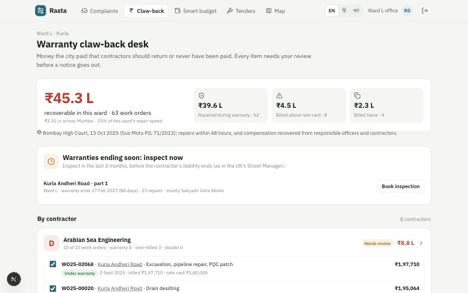
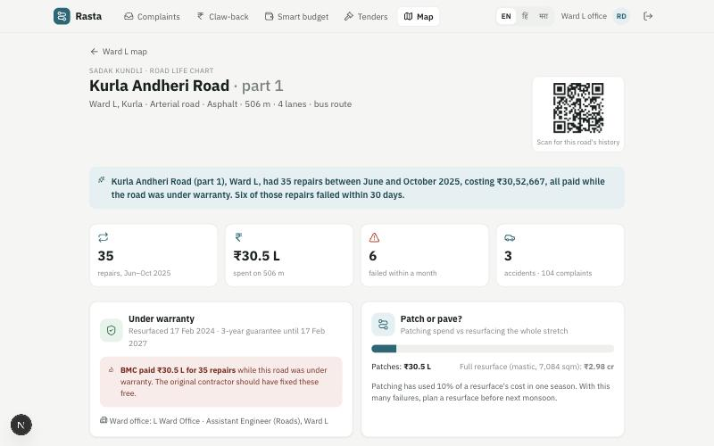
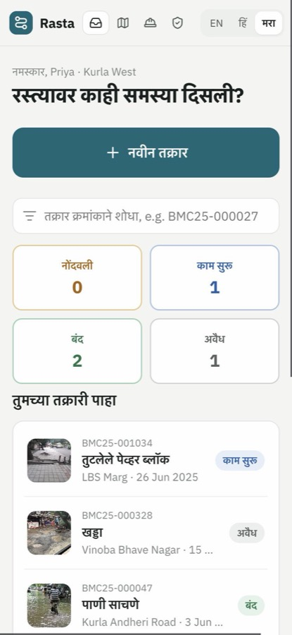
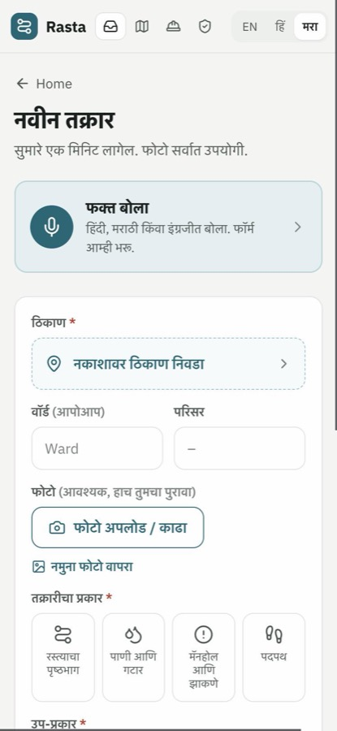
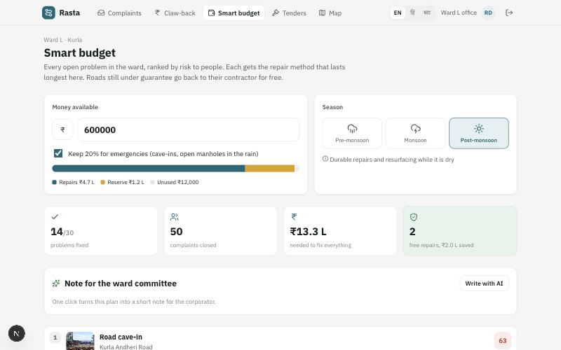

# Rasta: every rupee on Mumbai's roads, accounted for

> **Mumbai already tracks potholes. Nobody tracks who pays when the fix fails.**
> Rasta joins the complaint, the work order, the contractor, the bill and the warranty into one trail. It then turns repairs that failed under warranty into money the city can get back.

Built in one day at **Claude Impact Lab Mumbai** (21 Nov 2026) for the challenge *Follow the Rupee: Mumbai Monsoon Roads*.

| ₹13.43 cr | ₹3.35 cr | ₹3.07 cr | 35 repairs |
|---|---|---|---|
| spent on monsoon road repairs (2,499 work orders) | **recoverable**: paid during warranty, billed above the rate card, or billed twice | spent on repairs that failed within 30 days | on one 506 m stretch of Kurla Andheri Road, all while it was under warranty |

> All data is **synthetic** with planted patterns, and every contractor is fictional. The numbers show what the method finds, not facts about real Mumbai contractors.

<p>
  
  
</p>

## Where it fits

BMC's **MyBMC MARG** app takes complaints and closes them. The concretisation dashboard names contractors for new cement roads. **Neither shows the bill, whether the repair held, or whether the road was still under warranty**, and the two aren't linked. Rasta is the accountability layer that sits *after* MARG. It serves the **Bombay High Court order of 13 Oct 2025** (Suo Motu PIL 71/2013): repairs within 48 hours, and compensation recovered from responsible officers *and contractors*.

## What's inside

### For the ward officer
- **Warranty claw-back desk.** Every work order the city can recover, grouped by contractor:
  - surface repairs on roads under their 3-year Defect Liability Period
  - bills above 1.5× the rate card
  - possible double bills

  The officer reviews and unticks items, then Claude drafts a **recovery notice** in English, Hindi or Marathi that cites every work order ID. A **"warranties ending soon"** list prompts an inspection before the contractor's liability lapses.
- **Complaint inbox ranked by risk to people.** The score weighs:
  - severity and accident history
  - hospitals and schools nearby
  - flood hotspots, weighted by season, plus tide-sensitive spots
  - traffic and bus routes
  - public support and social-media chatter

  Claude screens each complaint (likely valid / invalid / needs info) and a human decides. The inbox is paginated, with an "Approved by you" view.
- **Smart budget.** Enter the money available, keep a 20% emergency reserve, and pick the season. Every open problem is ranked, given the repair method that fails least, and roads under warranty go back to their contractor for free. Claude writes a note for the ward committee.
- **Tenders.** Open a tender from the plan. Claude compares bids on price and on each contractor's BMC track record; new bidders are judged on the bid itself. The officer awards, and citizens see who is fixing their road.

### For the citizen
- **Report in a minute, in the style of MyBMC MARG.**
  - **Location:** a picker like a food-delivery app's, with search, "use current location", and the ward captured automatically.
  - **Photo:** Claude fills the grievance type, subtype and description from it.
  - **Voice first:** "Just say it" in Hindi, Marathi or English, and Claude fills the form.
  - **Duplicates:** if the same problem is already reported within 100 m, you can support it instead of filing again.
- **Track it:** status (Registered, In progress, Closed, Invalid), the service deadline, who fixed it, billed vs fair price, and before/after photos. Closed complaints can be rated or renewed, as in MARG.
- **Sadak Kundli**, a life chart for every road:
  - every repair, complaint, accident, rain day and big tide on one timeline
  - the warranty status, plus a "patch or pave?" meter
  - a QR code to open the page on a phone, and a one-line verdict from Claude
- **City map** with real BMC ward boundaries. Each ward shows budget allocated, spent and left, and every complaint dot leads to the repair job and the contractor's scorecard.
- **Contractor scorecards** a non-expert can read: an A–E grade, "3 of 10 repairs broke again within a month" (compared with peers in the same rain and flooding), and money questions.
- **RTI letter for a specific job.** It is pre-filled with that work order's amounts and with questions that match its flags.

### In three languages
English, **हिंदी** and **मराठी** across the main citizen and officer screens. The app detects the language of every complaint, including Hinglish. Wherever text isn't in the reader's language, a **Translate** link appears, as on Twitter, for both citizens and officers.

<p>
  
  
  
</p>

## How Claude is used

**Rule: code computes every number; Claude reads, explains and writes.** Audit flags, totals, priority scores and budget ranking are deterministic, so they can be reproduced and checked against an answer key.

| Job | Where |
|---|---|
| Photo → grievance type, subtype, severity, description, hazards | `lib/ai.ts › analyzePhoto` |
| Voice transcript → form fields, plus what's still missing | `formFromSpeech` |
| Complaint screening for the officer (human decides) | `triage` |
| Note for the ward committee | `planBrief` |
| Tender bid comparison | `analyzeBids` |
| Recovery notice and one-line road verdict | `recoveryNotice`, `roadVerdict` |
| Translation between English, Hindi, Marathi and Hinglish | `translate` |

All calls use structured outputs where a form is filled. The model is set by `RASTA_MODEL` (default `claude-haiku-5-5`, the cheapest). Without an API key the app still runs, using rule-based fallbacks.

## Run it locally

```bash
npm install
cp .env.example .env.local     # add ANTHROPIC_API_KEY
npm run dev                    # http://localhost:3000
```

The logins are demos and details are pre-filled. For the officer, choose **Ward L (Kurla)**: it has the most open complaints and the Kurla Andheri Road story.

| Variable | Needed | What for |
|---|---|---|
| `ANTHROPIC_API_KEY` | recommended | Every AI feature |
| `RASTA_MODEL` | no | Defaults to `claude-haiku-5-5` |
| `DEEPGRAM_API_KEY` | no | Speech-to-text for English/Hinglish (nova-3 multi) and Hindi (nova-2). Marathi uses the browser's recogniser. Without a key, the browser handles all three |
| `CLOUDINARY_URL` | **yes on Vercel** | `cloudinary://<api_key>:<api_secret>@<cloud_name>`. Shared storage for complaint photos and app state, so every serverless instance sees the same complaints |

## Deploy to Vercel

1. Import this repo in Vercel. The framework (Next.js) is detected automatically.
2. Under **Settings → Environment Variables** add `ANTHROPIC_API_KEY`, `CLOUDINARY_URL`, and optionally `RASTA_MODEL` and `DEEPGRAM_API_KEY`.
3. Deploy.

Things to know:
- **The dataset ships with the repo.** It lives in `data/*.json` and is bundled through `outputFileTracingIncludes`, so no database is needed.
- **Shared state lives in Cloudinary.** New complaints, support, decisions, tenders and notices are kept in one JSON file in Cloudinary (`rasta/state.json`), and photos in `rasta/photos/`. Every request reads the latest copy, so any serverless instance can serve any page. Without `CLOUDINARY_URL` the app uses a local file, which is fine on your laptop but not on Vercel. A real deployment would use a database.
- **Location:** GPS is watched for up to 12 seconds and the most accurate fix is kept; accuracy is shown as ±metres. Addresses and place search come from OpenStreetMap Nominatim.
- **AI calls take up to 30 seconds.** AI routes set `maxDuration = 60`.

## Demo script (3 minutes)

1. **Landing page:** ₹13.4 cr spent · **₹3.35 cr recoverable** · ₹3.07 cr didn't last.
2. **Citizen** (switch to मराठी):
   - Report a problem with "Just say it" and the sample voice note. The form fills itself and the map opens on LBS Marg.
   - Or use the sample Pothole photo, which shows "already reported, 23 m away"; choose to support it.
3. **Map → Ward L → a fixed dot:** the contractor's grade, billed vs fair price, and whether the repair held. Then "This road's full history".
4. **Sadak Kundli, Kurla Andheri Road:** 35 repairs, ₹30.5 L, all under warranty. Scan the QR code.
5. **Officer → Claw-back:** ₹45.3 L recoverable in Ward L. Review one contractor's items, then draft the notice in Hindi.
6. **Smart budget:** switch to Pre-monsoon and drains jump up the list. Open a tender, analyse the bids and award it.

## Project layout

```
app/            Next.js App Router pages and API routes
  citizen/      home, new complaint (location picker, photo AI, voice), complaint status
  officer/      inbox + AI triage, claw-back desk, smart budget, tenders
  roads/[id]    Sadak Kundli
  map/          ward map explorer
  contractors/  scorecards      rights/  deadlines, warranty lookup, RTI builder
lib/            data loading, priority score, claw-back engine, AI calls, i18n, store
data/           dataset + audit outputs as JSON (built by scripts/export_data.py)
scripts/        export_data.py (from the Rupee Trail audit engine), build_wards.py
public/samples  openly licensed demo photos (see CREDITS.md)
```

## Data and credits

- **Dataset:** [Claude-Impact-Labs-data-2](https://github.com/SumeetGDoshi/Claude-Impact-Labs-data-2) (CC BY 4.0). It is synthetic: complaints, work orders, roads, contractors, rainfall, tides, accidents, facilities and flood hotspots.
- **Audit rules:** over-billing above 1.5× the rate card; double bills (same road and method within 7 days with no complaint); repairs paid during the 3-year warranty; repairs failed within 30 days; missed deadlines.
- **Ward boundaries:** [DataMeet Municipal Spatial Data](https://github.com/datameet/Municipal_Spatial_Data).
- **Map tiles:** © OpenStreetMap contributors.
- **Sample photos:** Wikimedia Commons, credited in `public/samples/CREDITS.md`.

## License

MIT. See [LICENSE](LICENSE).
